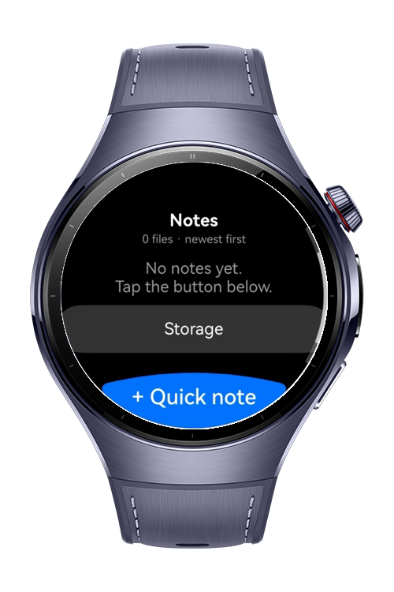
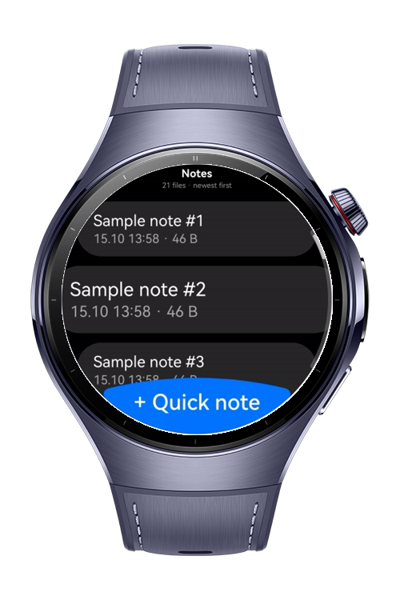
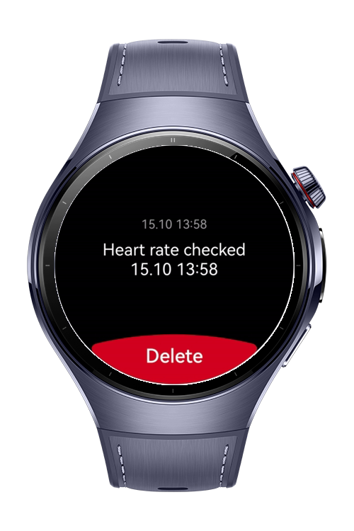
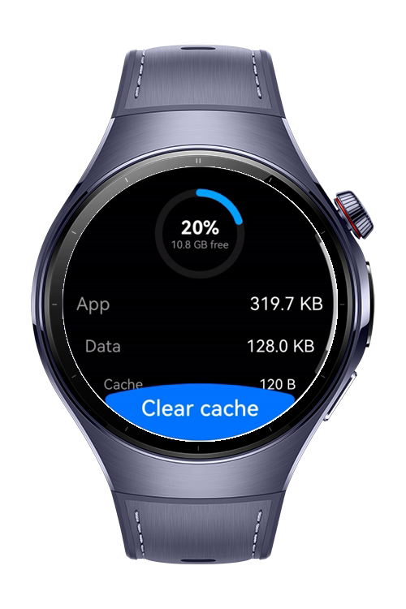

> **Note:** To access all shared projects, get information about environment setup, and view other guides, please visit [Explore-In-HMOS Index](https://github.com/Explore-In-HMOS/hmos-index).

# How to Implement Local File Storage in Wearable Apps

This codelab shows how to implement local file storage on HarmonyOS wearable devices using Core File Kit.  
The project is a one-tap quick notes app that stores each note as a file in the application sandbox, built with the MVVM architecture and State Management V2, and optimized for the limited storage, battery and screen of a smartwatch.

# Preview
<div>




</div>

# Use Cases
- Create, list, read and delete files with `fileIo` asynchronous APIs
- Write files atomically (`.tmp` → `fsync` → `rename`) so interrupted writes never corrupt data
- Use sandbox directories correctly: persistent notes in `filesDir`, a rebuildable index cache in `cacheDir`
- Read only what the UI needs: partial reads for list previews and a size cap per note
- Show cached data instantly on launch, then refresh from disk (stale-while-revalidate)
- Move batch file writes off the UI thread with `taskpool`
- Monitor app and file system space with `storageStatistics` and `statfs`, and warn on low storage via `@Monitor`
- Persist small UI preferences with `PersistenceV2` and share the ViewModel across pages with `AppStorageV2`
- Build a round-screen UI with `ArcList`, `ArcButton`, a ring `Progress` gauge and digital crown scrolling

# Tech Stack
- **Languages**: ArkTS, ArkUI
- **Frameworks**: HarmonyOS SDK 5.1.0(18) or later
- **Tools**: DevEco Studio 5.1.0 or later
- **Architecture**: MVVM with State Management V2
- **Libraries**: @kit.AbilityKit, @kit.ArkUI, @kit.ArkTS, @kit.CoreFileKit, @kit.BasicServicesKit, @kit.PerformanceAnalysisKit

# Directory Structure
```
entry/src/main/ets/
├── common
│    ├── AppConstants.ets
│    ├── FormatUtil.ets
│    └── Logger.ets
├── entryability
│    └── EntryAbility.ets
├── model
│    ├── AppSettings.ets
│    ├── NoteFile.ets
│    └── StorageInfo.ets
├── pages
│    └── Index.ets
├── service
│    ├── BatchWriter.ets
│    ├── FileService.ets
│    └── StorageService.ets
├── view
│    ├── components
│    │    ├── ActionChip.ets
│    │    ├── NoteListItem.ets
│    │    ├── StatRow.ets
│    │    └── StorageGauge.ets
│    ├── NoteDetailPage.ets
│    ├── NoteListView.ets
│    └── StoragePage.ets
└── viewmodel
     └── NotesViewModel.ets
```

# Constraints and Restrictions
## Supported Device
- Huawei Watch 5
## Preparations Before Run
- No permissions are required. Files inside the application sandbox are private to the app and can be accessed without requesting any permission.
- To run on a real device, **sign the application** first (automatic signing in DevEco Studio is sufficient).

# License

**How to Implement Local File Storage in Wearable Apps** is distributed under the terms of the MIT License. See the [LICENSE](LICENSE) for more information.
